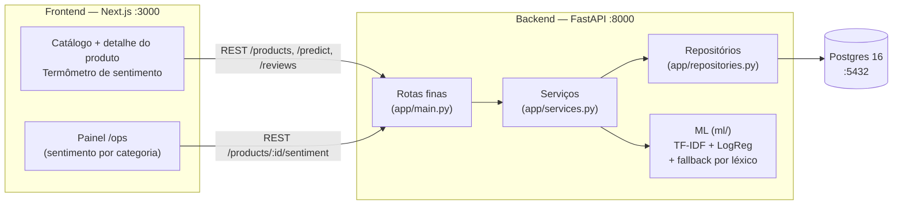

# Quantum Commerce Store — Análise de Sentimento em Reviews

Trabalho final de Machine Learning (FIAP MBA, turma 4AIER, Prof. Ahirton) —
**análise de sentimento em reviews (PT-BR)**

## O problema

A Quantum Commerce é uma gigante nativa digital do varejo omnicanal (12 países,
5 milhões+ de SKUs) que enfrenta o "muro da escalabilidade operacional":
manter a qualidade do suporte, a eficiência logística e a personalização por
métodos tradicionais tornou-se inviável nessa escala. Este trabalho endereça
um dos desafios propostos: **processar o volume de avaliações de clientes
para gerar um termômetro de satisfação por produto e por categoria** — o que
o cliente elogia, o que ele reclama, e onde a operação deve agir primeiro.

Cada produto mostra a distribuição de sentimento (% positivas / neutras / negativas), 
a média de estrelas, os termos mais citados de elogio e de crítica **das avaliações
daquele produto**, um resumo em prosa das
avaliações ("De 3 avaliações, 2 positivas e 1 negativa. O que mais elogiam:
... O que mais reclamam: ..." determinístico, sem LLM), e o cliente pode
escrever uma avaliação e ver a classificação ao vivo. 

No painel de operações (`/ops`), a Quantum vê por categoria quais produtos
concentram sentimento negativo.

## Decisão de dados: Olist + B2W real + demo na Quantum

| | |
|---|---|
| **Treino** | **Olist + B2W reais** — Brazilian E-Commerce Public Dataset (Kaggle, ~100 mil reviews PT-BR, 2016–2018) + B2W-Reviews01 (Americanas.com, 2018, 132 mil reviews). **Rótulo** derivado das estrelas: 1–2 negativo, 3 neutro, 4–5 positivo. |
| **Demo** | **Loja Quantum** — os 50 produtos do projeto Figma (5 categorias) + avaliações de demonstração em PT-BR + predição ao vivo de texto digitado. |

Por que assim: treinar só com dado sintético faria o modelo aprender apenas
os padrões que inventamos; treinar no Olist dá português real (gíria, erro de
digitação, ironia) e métricas honestas; o B2W entrou porque o
Olist sozinho tinha poucas neutras e negativas a escolha foi medida no
Colab em 3 versões (v1 Olist, v2 Olist+EDA, v3 Olist+B2W) e a v3 ganhou no
golden set (19/24, contra 13/24 da v1). A demo na Quantum mostra o modelo
funcionando no contexto da empresa. Os datasets **não estão no repo**
(baixar do Kaggle — ver "Treino"). Sem eles, o treino usa um dataset sintético
de demonstração (~922 reviews) para o pipeline rodar end-to-end.

## Arquitetura



Dois fluxos passam pelo `SentimentPredictor` (TF-IDF+LogReg; sem artefato, cai para o léxico):

- **Publicar uma avaliação:** cliente escreve o texto na página do produto → `POST /reviews` → `ReviewService `→ avaliação salva em reviews e predição salva em predictions (ligada à avaliação) → termômetro recalculado a partir de reviews + predictions.

- **Testar o modelo:** cliente digita um texto solto → `POST /predict` → `ReviewService` → só devolve a classificação na hora, sem criar avaliação nem mexer no termômetro.

## Stack

| Camada | Stack |
|---|---|
| Frontend | Next.js 15 + React 19 + TypeScript + Tailwind v4 (a partir do protótipo executado no Figma) |
| Backend | Python 3.12 + FastAPI + SQLAlchemy + scikit-learn |
| Banco | Postgres 16 via Docker (local); SQLite como fallback p/ testes |
| ML | TF-IDF + Regressão Logística (principal), MLP (comparação), baseline maioria |

## Estrutura de pastas

```
quantum-commerce-store/
├── docker-compose.yml      # postgres:16 + api (FastAPI :8000)
├── README.md               # este arquivo
├── frontend/               # Next.js (ver frontend/README.md)
│   └── src/app/            # /, /produto/[id] (termômetro), /ops
└── backend/                # Python (ver backend/README.md)
    ├── app/
    │   ├── main.py         # rotas finas (só delegam p/ serviços)
    │   ├── dependencies.py # composição raiz (DI manual)
    │   ├── schemas.py      # contratos Pydantic da API
    │   ├── services.py     # regras de negócio
    │   ├── repositories.py # único lugar com SQLAlchemy
    │   ├── models.py       # Product, Review, Prediction
    │   └── database.py     # engine/sessão (Postgres ou SQLite)
    ├── ml/
    │   ├── interfaces.py   # SentimentPredictor, ReviewDataSource
    │   ├── labels.py       # rótulos, nomes e versão do modelo
    │   ├── predictors.py   # TfidfLogRegPredictor, CompositePredictor
    │   ├── lexicon.py      # fallback por léxico PT-BR
    │   ├── datasets.py     # OlistReviewSource, B2WReviewSource, Combined, Csv, Synthetic
    │   ├── training.py     # ModelTrainer, MetricsReporter
    │   ├── train.py        # CLI fina de treino
    │   ├── sentiment.py    # fachada predict() (compatibilidade)
    │   ├── stopwords.py    # stopwords PT-BR
    │   └── artifacts/      # *.joblib (não versionado), metrics.json, top_terms.json
    ├── data/
    │   ├── products.json       # 50 produtos extraídos do Figma
    │   ├── seed_reviews.csv    # gerado pelo seed
    │   ├── olist_order_reviews_dataset.csv   # OPCIONAL: CSV do Olist (não versionado)
    │   └── b2w_reviews.csv                   # OPCIONAL: CSV do B2W (não versionado)
    ├── seed.py             # ProductSeeder + ReviewSeeder
    └── tests/              # pytest (25 testes)
```

## Como rodar (Mac)

```bash
# 1. Subir Postgres + API
cp .env.example .env                    # .env da RAIZ: o compose lê este
cp backend/.env.example backend/.env   # backend/.env: seed.py / uvicorn local
# ajuste POSTGRES_PASSWORD com a MESMA senha nos dois arquivos
docker compose up --build              # Postgres :5432 + API :8000

# 2. Popular o banco (em outro terminal)
cd backend
python -m venv .venv && source .venv/bin/activate
pip install -r requirements.txt
python seed.py                          # 50 produtos + 234 reviews

# 3. Treinar o modelo (gera ml/artifacts/)
python -m ml.train                     # sintético (~922 reviews)
# Com os datasets reais (Olist + B2W):
#   baixe olist_order_reviews_dataset.csv do Kaggle (ou pegue na
#   pasta `archive` do Drive) e salve como
#   backend/data/olist_order_reviews_dataset.csv; baixe b2w.csv
#   (pasta `archive-v2` do Drive) e salve como
#   backend/data/b2w_reviews.csv, depois:
python -m ml.train --olist --b2w

Versão passo a passo para aprender no Google Colab (mesmo pipeline, célula
por célula, com o CSV lido do Drive): `notebooks/treino-sentimento-olist-colab.ipynb`.

# 4. Frontend
cd ../frontend && npm install && npm run dev   # loja em http://localhost:3000
```

### Resumo com IA (opcional)

O endpoint `GET /products/{id}/summary` gera o parágrafo estilo Mercado
Livre com o Gemini. Precisa da chave do Google AI Studio em
`GEMINI_API_KEY` — no `backend/.env` (uvicorn local) e no `.env` da raiz
(o `docker-compose.yml` a interpola para o container da API). Sem a chave,
o resumo fica na versão determinística e nada quebra.

**Testar se a chave está ok** (do `backend/`, com o venv ativado):

```bash
python -c "from dotenv import load_dotenv; load_dotenv('.env'); from app.gemini_client import GeminiClient; c = GeminiClient(); print('chave:', c.available); print(repr(c.generate('Responda com a palavra: ok'))); print('erro:', c.last_error)"
```

- `'ok'` → chave e modelo funcionando.
- `None` + `HTTP 401` → a chave no `backend/.env` está errada ou revogada;
  troque pela chave nova do AI Studio.
- `None` + `HTTP 429` → limite de requisições do plano gratuito; espere
  1–2 min e tente de novo.
- `None` + `HTTP 503` → modelo sobrecarregado; espere, ou troque o modelo
  com `GEMINI_MODEL=gemini-flash-lite-latest` no `backend/.env`.

**Gerar os resumos de todos os produtos de uma vez** (aquece o cache; da
raiz do repo, com o Docker no ar e a chave no `backend/.env`):

```bash
backend/.venv/bin/python backend/scripts/generate_summaries.py
# só um produto:  ... --product 2
# regenerar mesmo os que já têm resumo:  ... --force
```

O script espera 7 s entre produtos (limite do plano gratuito) — os 50
produtos levam uns 8–10 min. O motivo de cada falha aparece por linha
("poucas avaliações (n, mínimo 3)" ou "erro do Gemini (HTTP ...)").

Sem Docker (testes locais): `USE_SQLITE=1` usa `backend/app.db`.
API fora do Docker: `cd backend && uvicorn app.main:app --reload --port 8000`.

## Endpoints

| Método | Rota | Descrição | Resposta |
|--------|------|-----------|----------|
| GET | `/health` | status + presença dos artefatos | `{status, model_dir, artifacts}` |
| GET | `/products?category=&search=` | lista produtos (50 do Figma) | lista de `ProductOut` |
| GET | `/products/{id}` | detalhe | `ProductOut` (404 se inexistente) |
| GET | `/products/{id}/sentiment` | termômetro do produto | `{product_id, total_reviews, avg_stars, counts, percentages, top_positive_terms, top_negative_terms}` |
| GET | `/products/{id}/summary` | resumo em prosa das avaliações | `{product_id, summary, source, model, review_count, cached}` — `source` é `gemini` (em cache) ou `deterministic` |
| GET | `/products/{id}/reviews?limit=50` | reviews com predição | lista de `ReviewOut` (`label`, `confidence`) |
| POST | `/reviews` | salva review + prevê sentimento | 201 `ReviewOut` |
| POST | `/predict` | classifica um texto avulso | `{label, label_pt, probabilities, confidence, model_name, model_version}` |

Contrato de campos (para o frontend): sentimento usa `counts` /
`percentages` (chaves `positive`, `neutral`, `negative`), `total_reviews` e
`avg_stars`; review usa `stars` (1–5, não `rating`); `POST /reviews` recebe
`{product_id, author, stars, text}`; produto usa `price_cents` (preço em
centavos), `image_url` e `reviews_count` — o front mapeia para `price`
(em reais), `image` e `reviews` em `src/lib/api.ts`.

Catálogo (desde 01/nov/2026): a home, o detalhe do produto e o `/ops`
buscam o catálogo na API (`GET /products`, `GET /products/{id}`) e só usam
o arquivo local `frontend/src/lib/products.ts` se a API não responder
(verificado: 50 produtos, 0 divergências contra o arquivo local; o `badge`
vem do arquivo local, pois não existe no banco).

## Modelos e métricas

- **Principal:** TF-IDF (1–2 gramas, max_features 8000, min_df 2,
  sublinear_tf, stopwords PT-BR) + Regressão Logística multinomial
  (C=4, class_weight=balanced).
- **Baseline:** classificador maioria (prevê sempre a classe mais comum).
- **Comparação:** MLPClassifier (1 camada oculta, 128 neurônios).
- **Rótulos:** estrelas 1–2 = negativo, 3 = neutro, 4–5 = positivo.
- **Fallback:** sem artefato treinado, `/predict` usa um léxico PT-BR com
  negação — a API nunca quebra.


| modelo | accuracy | F1-macro |
|---|---|---|
| baseline maioria | 0,619 | 0,255 |
| **LogReg (principal)** | **0,743** | **0,662** |
| MLP (comparação) | 0,751 | 0,604 |


F1 por classe (LogReg): positiva 0,831, negativa 0,812, neutra 0,344.
A classe neutra é o gargalo 11,4% do treino e textos ambíguos.
A MLP ganha em acurácia e perde em F1-macro, e treina numa
subamostra de 12.000 linhas porque densifica o TF-IDF. No golden
set da loja (24 itens), o modelo oficial faz 20/24 = 0,833. O
detalhe completo (as 3 versões do treino, matriz de confusão, top
termos) está no plano em `docs/plano-trabalho-final.md`.
