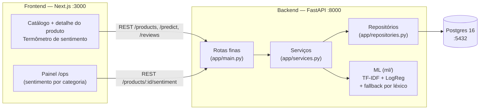

# Quantum Commerce Store — Análise de Sentimento em Reviews

Trabalho final de Machine Learning (FIAP MBA, turma 4AIER, Prof. Ahirton) —
**análise de sentimento em reviews (PT-BR)**, com referência ao Mercado Livre.
Prazo de entrega: **22/nov/2026**.

## O problema

A Quantum Commerce é uma gigante nativa digital do varejo omnicanal (12 países,
5 milhões+ de SKUs) que enfrenta o "muro da escalabilidade operacional":
manter a qualidade do suporte, a eficiência logística e a personalização por
métodos tradicionais tornou-se inviável nessa escala. Este trabalho endereça
um dos desafios propostos: **processar o volume de avaliações de clientes
para gerar um termômetro de satisfação por produto e por categoria** — o que
o cliente elogia, o que ele reclama, e onde a operação deve agir primeiro.

Na loja, isso aparece como no Mercado Livre: cada produto mostra a
distribuição de sentimento (% positivas / neutras / negativas), a média de
estrelas, os termos mais citados de elogio e de crítica, e o cliente pode
escrever uma avaliação e ver a classificação ao vivo. No painel de operações
(`/ops`), a Quantum vê por categoria quais produtos concentram sentimento
negativo.

## Decisão de dados: Olist real + demo na Quantum

| | |
|---|---|
| **Treino** | **Olist real** — Brazilian E-Commerce Public Dataset (Kaggle, ~100 mil reviews PT-BR, 2016–2018). Rótulo derivado das estrelas: 1–2 negativo, 3 neutro, 4–5 positivo. |
| **Demo** | **Loja Quantum** — os 50 produtos do projeto Figma (5 categorias) + avaliações de demonstração em PT-BR + predição ao vivo de texto digitado. |

Por que assim: treinar só com dado sintético faria o modelo aprender apenas
os padrões que inventamos; treinar no Olist dá português real (gíria, erro de
digitação, ironia) e métricas honestas; a demo na Quantum mostra o modelo
funcionando no contexto da empresa. O dataset do Olist **não está no repo**
(baixar do Kaggle — ver "Treino"). Sem ele, o treino usa um dataset sintético
de demonstração (~922 reviews) para o pipeline rodar end-to-end.

## Arquitetura



Fluxo de uma avaliação: cliente digita o texto → `POST /predict` (ou
`POST /reviews`) → `ReviewService` → `SentimentPredictor` (TF-IDF+LogReg;
sem artefato, cai para o léxico) → predição salva em `predictions` →
termômetro recalculado a partir de `reviews` + `predictions`.

## Stack

| Camada | Stack |
|---|---|
| Frontend | Next.js 15 + React 19 + TypeScript + Tailwind v4 (a partir do Figma) |
| Backend | Python 3.12 + FastAPI + SQLAlchemy + scikit-learn |
| Banco | Postgres 16 via Docker (local); SQLite como fallback p/ testes |
| ML | TF-IDF + Regressão Logística (principal), MLP (comparação), baseline maioria |

## Estrutura de pastas

```
quantum-commerce-store/
├── docker-compose.yml      # postgres:16 + api (FastAPI :8000)
├── README.md               # este arquivo
├── frontend/               # Next.js (ver frontend/README.md)
│   └── src/app/            # /, /produto/[id] (termômetro), /ops
└── backend/                # Python (ver backend/README.md)
    ├── app/
    │   ├── main.py         # rotas finas (só delegam p/ serviços)
    │   ├── dependencies.py # composição raiz (DI manual)
    │   ├── schemas.py      # contratos Pydantic da API
    │   ├── services.py     # regras de negócio
    │   ├── repositories.py # único lugar com SQLAlchemy
    │   ├── models.py       # Product, Review, Prediction
    │   └── database.py     # engine/sessão (Postgres ou SQLite)
    ├── ml/
    │   ├── interfaces.py   # SentimentPredictor, ReviewDataSource
    │   ├── labels.py       # rótulos, nomes e versão do modelo
    │   ├── predictors.py   # TfidfLogRegPredictor, CompositePredictor
    │   ├── lexicon.py      # fallback por léxico PT-BR
    │   ├── datasets.py     # OlistReviewSource, Csv, Synthetic
    │   ├── training.py     # ModelTrainer, MetricsReporter
    │   ├── train.py        # CLI fina de treino
    │   ├── sentiment.py    # fachada predict() (compatibilidade)
    │   ├── stopwords.py    # stopwords PT-BR
    │   └── artifacts/      # *.joblib (não versionado), metrics.json, top_terms.json
    ├── data/
    │   ├── products.json       # 50 produtos extraídos do Figma
    │   ├── seed_reviews.csv    # gerado pelo seed
    │   └── olist_order_reviews_dataset.csv   # OPCIONAL: CSV do Olist (não versionado)
    ├── seed.py             # ProductSeeder + ReviewSeeder
    └── tests/              # pytest (8 testes)
```

## Como rodar (Mac)

```bash
# 1. Subir Postgres + API
cp .env.example .env                    # .env da RAIZ: o compose lê este
cp backend/.env.example backend/.env   # backend/.env: seed.py / uvicorn local
# ajuste POSTGRES_PASSWORD com a MESMA senha nos dois arquivos
docker compose up --build              # Postgres :5432 + API :8000

# 2. Popular o banco (em outro terminal)
cd backend
python -m venv .venv && source .venv/bin/activate
pip install -r requirements.txt
python seed.py                          # 50 produtos + 234 reviews

# 3. Treinar o modelo (gera ml/artifacts/)
python -m ml.train                     # sintético (~922 reviews)
# Com o dataset real do Olist:
#   baixe olist_order_reviews_dataset.csv do Kaggle (ou pegue na
#   pasta `archive` do Drive) e salve como
#   backend/data/olist_order_reviews_dataset.csv, depois:
python -m ml.train --olist

Versão passo a passo para aprender no Google Colab (mesmo pipeline, célula
por célula, com o CSV lido do Drive): `notebooks/treino-sentimento-olist-colab.ipynb`.

# 4. Frontend
cd ../frontend && npm install && npm run dev   # loja em http://localhost:3000
```

Sem Docker (testes locais): `USE_SQLITE=1` usa `backend/app.db`.
API fora do Docker: `cd backend && uvicorn app.main:app --reload --port 8000`.

## Endpoints

| Método | Rota | Descrição | Resposta |
|--------|------|-----------|----------|
| GET | `/health` | status + presença dos artefatos | `{status, model_dir, artifacts}` |
| GET | `/products?category=&search=` | lista produtos (50 do Figma) | lista de `ProductOut` |
| GET | `/products/{id}` | detalhe | `ProductOut` (404 se inexistente) |
| GET | `/products/{id}/sentiment` | termômetro do produto | `{product_id, total_reviews, avg_stars, counts, percentages, top_positive_terms, top_negative_terms}` |
| GET | `/products/{id}/reviews?limit=50` | reviews com predição | lista de `ReviewOut` (`label`, `confidence`) |
| POST | `/reviews` | salva review + prevê sentimento | 201 `ReviewOut` |
| POST | `/predict` | classifica um texto avulso | `{label, label_pt, probabilities, confidence, model_name, model_version}` |

Contrato de campos (para o frontend): sentimento usa `counts` /
`percentages` (chaves `positive`, `neutral`, `negative`), `total_reviews` e
`avg_stars`; review usa `stars` (1–5, não `rating`); `POST /reviews` recebe
`{product_id, author, stars, text}`; produto usa `price_cents` (preço em
centavos), `image_url` e `reviews_count` — o front mapeia para `price`
(em reais), `image` e `reviews` em `src/lib/api.ts`.

Catálogo (desde 01/nov/2026): a home, o detalhe do produto e o `/ops`
buscam o catálogo na API (`GET /products`, `GET /products/{id}`) e só usam
o arquivo local `frontend/src/lib/products.ts` se a API não responder
(verificado: 50 produtos, 0 divergências contra o arquivo local; o `badge`
vem do arquivo local, pois não existe no banco).

## Modelos e métricas

- **Principal:** TF-IDF (1–2 gramas, max_features 8000, min_df 2,
  sublinear_tf, stopwords PT-BR) + Regressão Logística multinomial
  (C=4, class_weight=balanced).
- **Baseline:** classificador maioria (prevê sempre a classe mais comum).
- **Comparação:** MLPClassifier (1 camada oculta, 128 neurônios).
- **Rótulos:** estrelas 1–2 = negativo, 3 = neutro, 4–5 = positivo.
- **Fallback:** sem artefato treinado, `/predict` usa um léxico PT-BR com
  negação — a API nunca quebra.

Último treino registrado (`backend/ml/artifacts/metrics.json`) — Olist
real, 31/out/2026 (34.149 treino / 8.538 teste, 42.687 avaliações com
texto):

| modelo | accuracy | F1-macro |
|---|---|---|
| baseline maioria | 0,657 | 0,264 |
| **LogReg (principal)** | **0,780** | **0,635** |
| MLP (comparação) | 0,787 | 0,600 |

F1 por classe (LogReg): positiva 0,886, negativa 0,761, neutra 0,259.
A classe neutra é o gargalo — só 8,5% do treino e textos ambíguos.
A MLP ganha em acurácia e perde em F1-macro, e treina numa
subamostra de 12.000 linhas porque densifica o TF-IDF. O detalhe
completo (matriz de confusão, top termos) está no plano em
`docs/plano-trabalho-final.md`.

> **Aviso honesto:** o treino sintético de demonstração (922 linhas)
> dá F1 = 1,0 nos dois modelos — artefato dos templates que se
> sobrepõem, não resultado real. Não apresentar 1,0 como desempenho
> do modelo.

## OOP, SOLID e Clean Code

Padrão exigido para o projeto: **orientação a objetos, clean code e SOLID
em toda a estrutura do código**. O backend foi refatorado para camadas
(`routes → services → repositories`, `ml/` por interfaces); o detalhe
completo está em `backend/README.md`.

| Princípio | Onde (classe / arquivo) |
|---|---|
| **S — Responsabilidade única** | Cada classe faz uma coisa: `ProductRepository` só acessa dados (`app/repositories.py`); `ReviewService` só orquestra review+predição (`app/services.py`); `ModelTrainer` só treina (`ml/training.py`); `MetricsReporter` só persiste/imprime métricas |
| **O — Aberto/fechado** | Novo modelo = nova classe implementando `SentimentPredictor` (`ml/interfaces.py`, ex.: `TfidfLogRegPredictor` em `ml/predictors.py`); nova fonte = nova classe implementando `ReviewDataSource` (`ml/datasets.py`, ex.: `OlistReviewSource`). Nenhum serviço muda |
| **L — Substituição de Liskov** | `LexiconFallbackPredictor` e `TfidfLogRegPredictor` são substituíveis em qualquer lugar que espera um `SentimentPredictor`; `OlistReviewSource`, `CsvReviewSource` e `SyntheticReviewSource` são substituíveis onde se espera um `ReviewDataSource` |
| **I — Segregação de interfaces** | Interfaces pequenas e coesas: `SentimentPredictor` só tem `predict` / `is_available` / `name`; `ReviewDataSource` só tem `load` / `name` — nenhuma classe é obrigada a implementar o que não usa |
| **D — Inversão de dependência** | `ReviewService` e `ModelTrainer` dependem das abstrações `SentimentPredictor` / `ReviewDataSource`, não das implementações; os objetos concretos são montados num só lugar, a composição raiz (`app/dependencies.py` p/ API, CLI de `ml/train.py` p/ treino) |

Clean code aplicado: nomes em inglês no código (PT-BR só em textos de UI e
docs), métodos curtos com um nível de abstração, sem duplicação (a regra de
rótulo por estrelas vive só em `ml/labels.py`), sem números mágicos sem nome
(`LOGREG_C`, `TFIDF_MAX_FEATURES`, `MIN_REVIEWS_PER_PRODUCT` etc.) e type
hints em todo o código novo.

## Limitações (a declarar no trabalho)

1. **Docker / Postgres não testados nesta VM** (não há Docker aqui). O
   `docker-compose.yml`, o `Dockerfile` e a URL `postgresql+psycopg` seguem
   o padrão, mas a validação real (`docker compose up` + seed no Postgres)
   precisa acontecer no Mac. Testes, treino e smoke test rodaram com o
   fallback SQLite (`USE_SQLITE=1`).
2. **Olist não incluído no repo** (dataset externo do Kaggle, 14 MB).
   Sem `backend/data/olist_order_reviews_dataset.csv`, o treino usa o
   sintético — e as métricas desse treino não são generalizáveis
   (ver aviso acima). O treino real já foi feito em 31/out/2026
   (F1-macro LogReg 0,635); os artefatos `*.joblib` não são
   versionados — para reproduzir, baixe o CSV e rode `--olist`.
3. **Reviews da demo são sintéticas** (234 reviews geradas de templates,
   seed 42). O termômetro da loja demonstra o fluxo, não a satisfação real
   de clientes da Quantum — para validar a transferência Olist → Quantum
   falta um golden set manual de reviews dos 50 produtos.
4. **Integração frontend ↔ backend:** o contrato da API é o da tabela
   acima (`total_reviews` / `counts` / `percentages` / `avg_stars`,
   `stars`). O frontend deve ler esses campos — qualquer leitura de nomes
   diferentes (`total`, `rating`) precisa ser ajustada no frontend.
5. Escopo da disciplina: sem CNN/RNN/Transformer/BERT como base — citados
   apenas como evolução futura. O MLP aqui é o teto de rede neural do trabalho.
